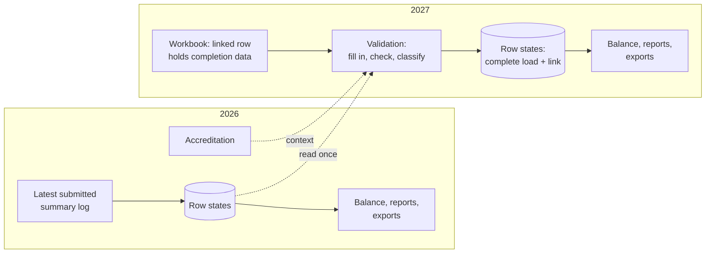
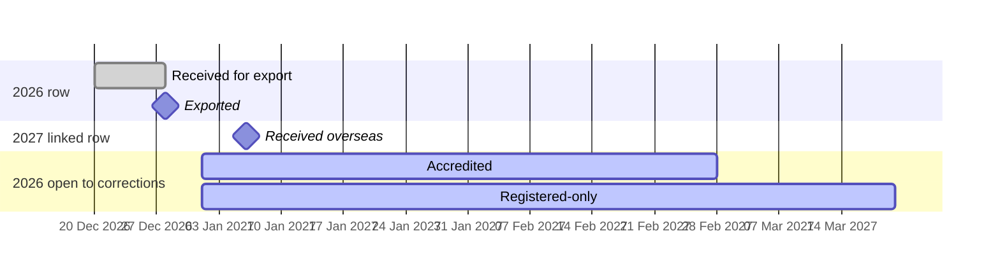

# Summary Log Cross-Year Links: High Level Design

Proposed with [ADR-0060](../decisions/0060-cross-year-linked-summary-log-rows.md). The mechanics are in the [LLD](./summary-log-cross-year-links-lld.md).

An exporter can export a load in one year that is received overseas in the next, or receive a load for export in one year and export it in the next. From 2027 the operator records the completion on a 2027 row that names the 2026 row in its previous-year row ID column. Validation fills in the rest of the load from the 2026 row, and the load counts towards the 2027 balance.

## Where the years meet

- The only cross-year access is that read, at validation. Nothing is written across the year boundary.
- A 2027 row state holds the complete load, so every 2027 reader treats a linked row like any other.
- The previous year's position and accreditation join the validation context, so a 2026 change before 2027 submission supersedes the 2027 log.

## Timeline of a linked load

| Window                              | Linked rows                                                                                                                                                           |
| ----------------------------------- | --------------------------------------------------------------------------------------------------------------------------------------------------------------------- |
| Before the previous year's deadline | Supply only the export and overseas columns, and may not change a value the 2026 row already holds. Corrections go on the 2026 row and supersede in-flight 2027 logs. |
| After the deadline                  | Overrides on the linked row ([PAE-2107](https://eaflood.atlassian.net/browse/PAE-2107)): out of scope                                                                 |

## What changes

| Component                                         | Change                                                                    |
| ------------------------------------------------- | ------------------------------------------------------------------------- |
| 2027 exporter templates                           | `ROW_ID` generated on linked rows                                         |
| Table schemas                                     | Declare that a table links years, and the columns a linked row may supply |
| Validation                                        | Resolves links, fills in, checks the years against each other             |
| Context builder (validation and submission)       | Adds the previous year's position and accreditation                       |
| Classification                                    | Checks the export date against the accreditation of that date's year      |
| Check-page period status, tonnage monitoring      | Count rows only in their own summary log's year                           |
| Waste balance, reports, exports, credited tonnage | None                                                                      |

## Out of scope

- Recalculating 2027 when a 2026 row changes after the 2027 submission ([PAE-2302](https://eaflood.atlassian.net/browse/PAE-2302)): the change arrives at the next 2027 upload.
- Overrides after the deadline, link edge cases ([PAE-2097](https://eaflood.atlassian.net/browse/PAE-2097), [PAE-2098](https://eaflood.atlassian.net/browse/PAE-2098)), renamed columns, per-year site approvals, refused, stopped and repatriated loads, and links across streams.
