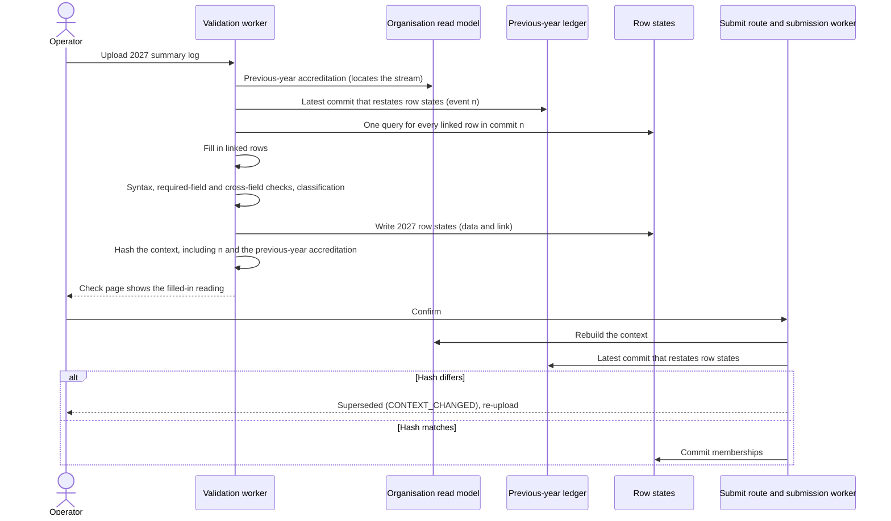
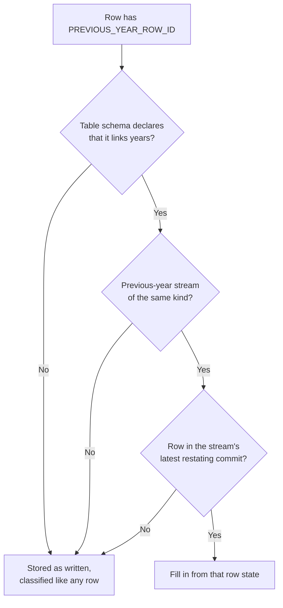
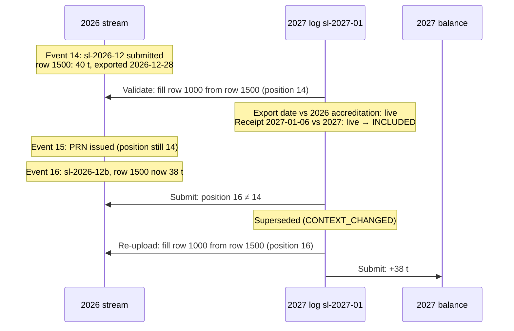

# Summary Log Cross-Year Links: Low Level Design

Proposed with [ADR-0060](../decisions/0060-cross-year-linked-summary-log-rows.md), which records the decisions and their reasons. This document shows the mechanics. For the overview, see the [HLD](./summary-log-cross-year-links-hld.md).

<!-- prettier-ignore-start -->
<!-- TOC -->

- [Summary Log Cross-Year Links: Low Level Design](#summary-log-cross-year-links-low-level-design)
  - [Validation and submission](#validation-and-submission)
  - [Resolving a link](#resolving-a-link)
  - [Filling in a linked row](#filling-in-a-linked-row)
  - [Template changes](#template-changes)
  - [Cross-field rounding allowance](#cross-field-rounding-allowance)
  - [Row state](#row-state)
  - [Credit](#credit)
  - [Context](#context)
  - [Readers that place rows by date](#readers-that-place-rows-by-date)
  - [Worked example](#worked-example)
    <!-- TOC -->
    <!-- prettier-ignore-end -->

## Validation and submission

The previous year's commit is read once per validation. Fill-in and the context both use it, so rows are never filled from one submission while the context records another.



## Resolving a link



Rows left unresolved are rejected once [PAE-2097](https://eaflood.atlassian.net/browse/PAE-2097) lands.

| 2027 summary log  | Previous-year stream                                                     |
| ----------------- | ------------------------------------------------------------------------ |
| Accredited        | The 2026 accredited stream, via the 2026 accreditation in the read model |
| Registered-only   | The 2026 registered-only stream                                          |
| Either, no stream | None: every link is unresolved and the previous-year position is `null`  |

The 2026 accreditation is a separate record, so the 2027 ledger id with the year changed does not find it.

**Linking tables** (Exported tab, from 2027, [PAE-2283](https://eaflood.atlassian.net/browse/PAE-2283)):

| Template                 | Table                       | Fill-in | Credit rule |
| ------------------------ | --------------------------- | ------- | ----------- |
| Accredited exporter      | `RECEIVED_LOADS_FOR_EXPORT` | Yes     | Yes         |
| Registered-only exporter | `LOADS_EXPORTED`            | Yes     | No balance  |

**The read.** One query, served by the existing `summary_log_row_state_identity_by_year` index. A log with no previous-year row IDs skips it.

```
{
  organisationNumber, registrationNumber,
  accreditationNumber: <previous-year accreditation>,
  year: 2026,
  rowId: { $in: [ …the log's previous-year row IDs… ] },
  wasteRecordType: "exported",
  summaryLogIds: <summary log named by commit n>
}
```

## Filling in a linked row

Fill-in runs before every other validation step.

| Cell on the 2027 row                             | Filled-in value       | In `suppliedFields` |
| ------------------------------------------------ | --------------------- | ------------------- |
| Blank                                            | Previous-year value   | No                  |
| On its template default (dropdown placeholder)   | Previous-year value   | No                  |
| Supplied, equal to the previous-year value       | Supplied value        | Yes                 |
| Supplied, different from the previous-year value | Rejected ([PAE-2102]) | n/a                 |
| Formula cell                                     | As any other cell     | As any other cell   |
| `ROW_ID`, `PREVIOUS_YEAR_ROW_ID`                 | Never filled          | n/a                 |
| Not declared by the 2027 template                | Never filled          | n/a                 |

[PAE-2102]: https://eaflood.atlassian.net/browse/PAE-2102

- Supplied values are rounded to the stored precision before comparison: 10.123 against a stored 10.12 is equal.
- The placeholder rule applies only to fill-in. Unlinked rows still store an untouched placeholder verbatim in the columns that do so today.
- A renamed column needs an explicit mapping. Renames are out of scope.
- Overrides after the deadline ([PAE-2107](https://eaflood.atlassian.net/browse/PAE-2107)) are out of scope. Without them, a formula cell is blank (and inherits) or computed from inputs equal to the previous-year values, so fill-in needs no knowledge of the formulas.

Validation holds three versions of a linked row:

| Version                     | Read by                                                                                                                         |
| --------------------------- | ------------------------------------------------------------------------------------------------------------------------------- |
| Previous-year row as stored | Rules that compare the years: earlier-year dates ([PAE-2101]), overrides ([PAE-2102]), and the others in the epic's rules table |
| Row as entered              | The same rules                                                                                                                  |
| Filled-in row               | Syntax, required-field and cross-field checks, classification, the check page, the stored `data`                                |

[PAE-2101]: https://eaflood.atlassian.net/browse/PAE-2101

The earlier-year date rule checks supplied cells only, and allows a supplied earlier-year date equal to the previous-year row's.

| Column                 | 2026 row `1500` | 2027 row `1000` as entered | 2027 row `1000` filled in |
| ---------------------- | --------------- | -------------------------- | ------------------------- |
| `DATE_OF_EXPORT`       | 2026-12-28      | (blank)                    | 2026-12-28, inherited     |
| `OSR_ID`               | 012             | 012                        | 012, supplied (unchanged) |
| `DATE_RECEIVED_BY_OSR` | (blank)         | 2027-01-06                 | 2027-01-06, supplied      |

## Template changes

Needed on both 2027 exporter templates before they go out. They go beyond [PAE-2293](https://eaflood.atlassian.net/browse/PAE-2293), so they need agreeing with the template owner.

| Column                                  | Today                                                  | Needed                                                           | Why                                                      |
| --------------------------------------- | ------------------------------------------------------ | ---------------------------------------------------------------- | -------------------------------------------------------- |
| Formula columns, e.g. `NET_WEIGHT`      | `IFERROR(K-L-M,"")` gives 0 when the weights are blank | Blank unless every input on the row is filled                    | A 0 would override the previous-year value               |
| `ROW_ID`                                | Generated from columns a linked row inherits           | Generated when `PREVIOUS_YEAR_ROW_ID` or any data cell is filled | A row supplying only a receipt date would have no row ID |
| `WERE_PRN_OR_PERN_ISSUED_ON_THIS_WASTE` | Defaults to "No"                                       | Defaults to the placeholder                                      | An untouched "No" would override a previous-year "Yes"   |

## Cross-field rounding allowance

Inherited weights and tonnages are stored at two decimal places; the recyclable proportion is stored as entered. On a row whose `data` has a previous-year row ID, each cross-field check widens its comparison by what that rounding can account for. Unlinked rows keep today's comparison.

| Export tonnage check: source of rounding | Allowance     |
| ---------------------------------------- | ------------- |
| Stored tonnage                           | 0.005 t       |
| Net weight, from three rounded weights   | up to 0.015 t |
| Non-target weight                        | up to 0.005 t |
| **Total**                                | **≈ 0.025 t** |

The net weight check needs none: the stored net weight is re-derived from the stored weights.

| 2026 load                      | Recalculated on the linked row | Stored | Difference | Result   |
| ------------------------------ | ------------------------------ | ------ | ---------- | -------- |
| 10.12 t at proportion 0.37     | 3.7444 t                       | 3.74 t | 0.0044 t   | Passes   |
| Same, with a tonnage of 3.80 t | 3.7444 t                       | 3.80 t | 0.056 t    | Rejected |

A cross-field error on a linked row names the values that came from the previous-year row.

## Row state

```
{
  …row identity…,
  data: { …filled-in, coerced row… },
  link: {
    year: 2026,
    rowId: 1500,
    rowStateId: "…",         // the previous-year row state it was filled in from
    suppliedFields: [ … ]     // per the fill-in table
  },
  classification: { … },
  summaryLogIds: [ … ]
}
```

- No reader of the balance, reports or exports reads `link`. Row history and a later recalculation ([PAE-2302](https://eaflood.atlassian.net/browse/PAE-2302)) do.
- `link` is part of the content hash, so a new previous-year row state gives a new document even when `data` is unchanged.

## Credit

Accredited exporter rows, linked or not:

| Date received overseas            | Date of export | Export date checked against | Credited when                    |
| --------------------------------- | -------------- | --------------------------- | -------------------------------- |
| Current year, on a live 2027 day  | Current year   | 2027 accreditation          | 2027 accreditation live that day |
| Current year, on a live 2027 day  | Previous year  | 2026 accreditation          | 2026 accreditation live that day |
| Current year, on a live 2027 day  | Previous year  | No 2026 accreditation       | Never                            |
| Blank, previous year, or not live | Any            | n/a                         | Never                            |

Overseas-site approval is checked against the export date using the current year's sites. Readers that reclassify at read time (waste-records exports, market insights waste balance) resolve the previous-year accreditation the same way.

## Context

For a template with a table that links years, the context gains two fields. Other templates omit them, so their hashes are unchanged.

| Field                       | Value                                                                  |
| --------------------------- | ---------------------------------------------------------------------- |
| Previous-year position      | Event number of the previous year's latest restating commit, or `null` |
| Previous-year accreditation | The previous year's accreditation, or `null`                           |

The hash covers the whole context except table schemas. One builder serves validation, the submit route and the submission worker.

| Between validation and submission           | Position  | Superseded |
| ------------------------------------------- | --------- | ---------- |
| Previous-year resubmission                  | Changes   | Yes        |
| First previous-year submission (was `null`) | Changes   | Yes        |
| Previous-year accreditation changes         | Unchanged | Yes        |
| PRN event on the previous-year stream       | Unchanged | No         |

Every in-flight later-year log in the stream is affected, linked or not, until the previous year closes: end of February (accredited) or 20 March (registered-only) ([PAE-2106](https://eaflood.atlassian.net/browse/PAE-2106)).

## Readers that place rows by date

Each counts a row only in periods of its own summary log's year.

| Reader                                              | Places exporter rows by                                            | Change                                                                    |
| --------------------------------------------------- | ------------------------------------------------------------------ | ------------------------------------------------------------------------- |
| Monthly reports                                     | Received for export, exported and repatriated dates                | None                                                                      |
| Credited tonnage                                    | Date received overseas, credited rows only                         | None                                                                      |
| Market insights waste balance                       | Date received overseas, latest submission of every ledger and year | None                                                                      |
| Check-page period status and resubmission detection | Received for export, exported and repatriated dates                | Own year's submitted periods only, so December 2026 isn't shown as closed |
| Tonnage monitoring                                  | Date of export, latest submission of every ledger and year         | Own year's months only, so a December 2026 export isn't counted twice     |

## Worked example



Had the PRN event been the only change, `sl-2027-01` would have committed with 40 t. Had 2027 been submitted before the correction, the balance would stay at 40 t until the next 2027 upload refills row `1000` with 38 t.

A load received in December 2026 and exported in January 2027 (2026 row `1600`, linked 2027 row `1001`):

| Report        | Shows                    | From     |
| ------------- | ------------------------ | -------- |
| December 2026 | 25 t received for export | 2026 row |
| January 2027  | 25 t exported            | 2027 row |

On the 2027 check page, row `1001`'s December 2026 date places it in no period, so it is an open-period load even if the December 2026 report is submitted.
